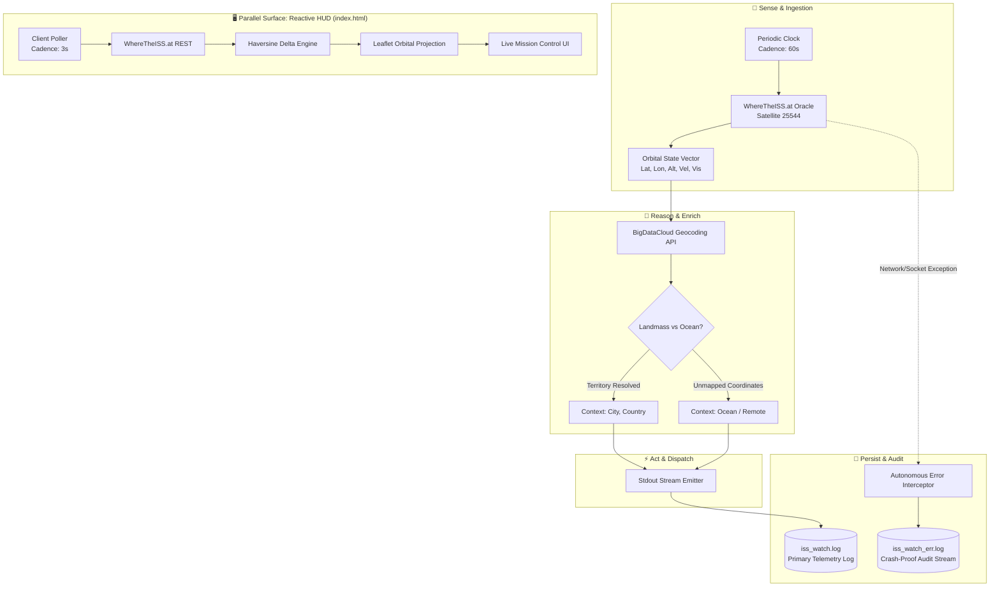

<div align="center">

# 🛰️ ISS Watch Loop
### Autonomous Orbital Telemetry Agent & Real-Time Observer

[](https://iss-watch-loop.vercel.app)
[](specs/system-spec.md)
[](specs/system-spec.md)
[](specs/README.md)
[](iss_watch.py)

<p align="center">
  <b>An autonomous, unattended telemetry ingestion loop paired with a high-density reactive spatial HUD.</b><br/>
  Demonstrating <b>Concept 4: In-Session Autonomous Loops</b> in production Agentic AI Systems.
</p>

[**Explore Live Dashboard**](https://iss-watch-loop.vercel.app) • [**System Architecture Spec**](specs/system-spec.md) • [**Telemetry Schema**](specs/telemetry-schema.md) • [**Run Locally**](#-quick-start)

---

</div>

## 🌐 Overview & Agentic Philosophy

In agentic systems, an **In-Session Loop** acts as an autonomous heartbeat. Instead of relying on ad-hoc human polling or bloated external orchestration services, an in-session loop runs unattended within the lifecycle of the active session. It continually observes environment state, filters and enriches spatial intelligence, and dispatches durable side-effects without intervention.

**ISS Watch Loop** implements this paradigm to track the **International Space Station (NORAD ID: 25544)** in real time:

- **Sense**: Autonomous polling of orbital state vectors via TLS 1.3 socket connections.
- **Reason**: Spatial ground-truth synthesis (geopolitical territory vs. open international waters).
- **Act**: Formatted console telemetry broadcast.
- **Persist**: Multi-channel append-only disk logging with microsecond UTC indexing.
- **Observe**: Low-latency browser-based spatial HUD with dynamic orbital breadcrumb mapping.

---

## 🏛️ System Architecture

The end-to-end telemetry pipeline consists of a headless Python agent loop and a client-side reactive geospatial observer:



---

## 📐 Formal Specifications

The system is built against formal engineering specifications located in the [`/specs`](specs/README.md) directory:

| Spec Document | Focus Area | Details |
| :--- | :--- | :--- |
| [**`specs/system-spec.md`**](specs/system-spec.md) | **System Architecture & Lifecycle** | In-Session Loop Invariants, Perception-Action Cycle, Finite State Machine (FSM), resilience & error containment. |
| [**`specs/telemetry-schema.md`**](specs/telemetry-schema.md) | **Data Contracts & Schemas** | JSON Schemas for `ISSStateVector`, Reverse-Geocode fallbacks, append-only log formats, and HUD state models. |

---

## 🔬 Loop Engineering: Concept 4 Deep Dive

Why does this architecture matter in Agentic AI Engineering?

| Execution Model | Autonomy Level | Fault Containment | Overhead | Agentic Fit |
| :--- | :---: | :---: | :---: | :---: |
| **Manual Polling** | ❌ None | Manual intervention | High | Poor |
| **In-Session Loop (This Project)** | ✅ **Autonomous** | **Process-isolated** | **Zero-Dependency** | **Ideal for active workloads** |
| **Decoupled Daemon / Cron** | ✅ Autonomous | OS-level / Service | High setup | Better for multi-day batch |

### Core Architectural Invariants:
1. **Crash Containment**: External socket timeouts (`timeout=30s`) and upstream HTTP errors are caught and directed to `iss_watch_err.log`. The parent supervisor loop **never crashes**.
2. **Zero Runtime Dependencies**: The headless agent relies entirely on Python's Standard Library (`urllib.request`, `json`, `time`, `pathlib`).
3. **Session-Bound Scope**: Cleanly terminates with standard `SIGINT` (`Ctrl+C`) or session closure, leaving zero orphaned background processes.

---

## 🚀 Dual Interface Surfaces

### Surface A: Headless Autonomous Daemon (`iss_watch.py`)

A pure-Python terminal loop designed for non-interactive servers, telemetry pipelines, and agent sidecars.

```bash
# Execute the autonomous in-session watch loop
python iss_watch.py
```

**Live Output Sample:**
```log
2026-11-14 04:14:28 UTC | Lat: -21.4920 | Lon: 130.1492 | Location: near Tanami, Australia
2026-11-14 04:15:28 UTC | Lat: -25.2911 | Lon: 134.8104 | Location: near Finke, Australia
2026-11-14 04:16:28 UTC | Lat: -29.0118 | Lon: 139.7820 | Location: over an ocean or remote area
```

---

### Surface B: Mission Control Reactive HUD (`index.html`)

A high-density space-themed dashboard accessible at [**iss-watch-loop.vercel.app**](https://iss-watch-loop.vercel.app):

- 🛰️ **Live Orbital Marker & Radar Halo**: Real-time position rendered on Leaflet dark cartography.
- 📐 **Trajectory Breadcrumbs**: Auto-updating polyline showing recent orbital trajectory.
- ⚡ **Kinematic Telemetry**: Live orbital velocity (~27,600 km/h) and altitude (~420 km).
- 🧭 **Haversine Delta Engine**: Calculates exact distance traversed between telemetry pings.
- ☀️ **Daylight / Eclipse Detection**: Visual indication of solar visibility (astronauts witness 16 sunsets daily).
- 🛠️ **Deep Telemetry Inspector**: Collapsible developer panel showing raw subsolar coordinates and ground footprint.

---

## ⚡ Quick Start

### 1. Run Headless Python Agent
```bash
# Clone the repository
git clone https://github.com/SainBux-HadiSeelro/ISS-watch-loop.git
cd ISS-watch-loop

# Start the unattended loop
python iss_watch.py
```

### 2. Launch Local Web HUD
```bash
# Option 1: Native browser launch (Windows PowerShell)
Start-Process index.html

# Option 2: Lightweight HTTP server
python -m http.server 8000
# Navigate to http://localhost:8000
```

---

## 📂 Repository Structure

```
ISS-watch-loop/
├── index.html               # Surface B: High-density Leaflet Cartographic HUD
├── iss_watch.py             # Surface A: Headless Autonomous In-Session Loop Agent
├── iss_watch.log            # Primary append-only telemetry stream (UTC indexed)
├── iss_watch_err.log        # Error containment audit stream
├── readme.md                # Agentic AI Developer Documentation
└── specs/                   # Formal Engineering Specifications
    ├── README.md            # Specifications Directory Index & Compliance Checklist
    ├── system-spec.md       # SPEC-LOOP-004-ISS: Architecture, FSM, and Invariants
    └── telemetry-schema.md  # SCHEMA-LOOP-004-ISS: Data Contracts & JSON Schemas
```

---

## 🛡️ Autonomous Error Recovery Matrix

| Fault Condition | Detection Mechanism | Recovery Action | Target Stream |
| :--- | :--- | :--- | :--- |
| **Upstream Oracle Down (5xx / 429)** | `urllib.error.HTTPError` | Suppress panic; log exception; wait for next cadence cycle. | `iss_watch_err.log` |
| **DNS / Network Disconnect** | `urllib.error.URLError` | Non-blocking retry on next tick; zero process termination. | `iss_watch_err.log` |
| **Reverse Geocoder Timeout** | Socket timeout (`timeout=30`) | Gracefully fallback to `"over an ocean or remote area"`. | `iss_watch.log` |
| **Invalid JSON Frame** | `json.JSONDecodeError` | Discard corrupted packet; record fault. | `iss_watch_err.log` |

---

<div align="center">

Crafted with precision for **Loop Engineering & Autonomous Agent Architectures**.

</div>
