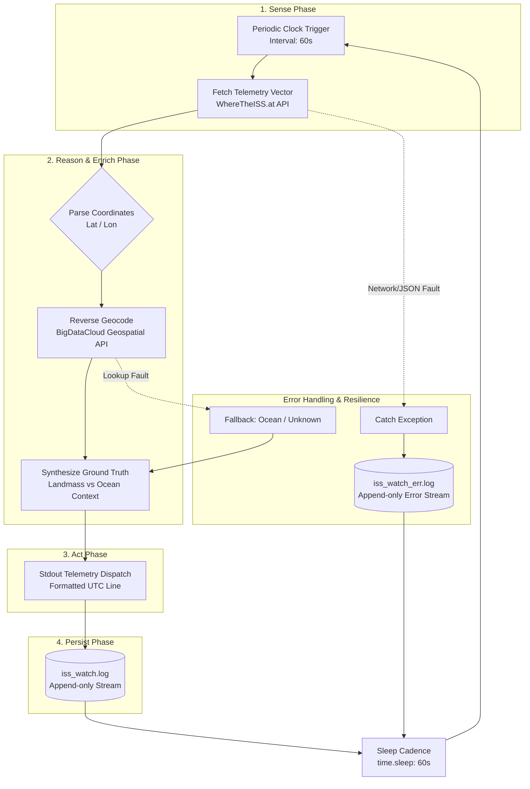
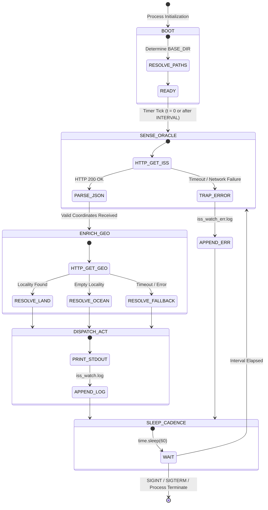

# 🛰️ ISS Watch Loop — System Specification
**Document ID:** `SPEC-LOOP-004-ISS`  
**Standard:** Loop Engineering Framework (Concept 4: In-Session Autonomous Loops)  
**Status:** Approved  
**Classification:** Agentic Systems Architecture  

---

## 1. Executive Summary

The **ISS Watch Loop** is an autonomous in-session telemetry agent designed to observe, enrich, and persist real-time orbital telemetry for the International Space Station (NORAD ID: `25544`). Operating within the **Loop Engineering Concept 4** paradigm, the agent executes unattended cyclic iterations (Sense ➔ Process ➔ Act ➔ Persist) while maintaining session-bound execution boundaries, high fault tolerance, and zero third-party runtime dependencies.

---

## 2. Agentic Loop Architecture

The system implements a classic **Autonomous Perception-Action Cycle**:



### 2.1 Four-Phase Cycle Definition

| Phase | Responsibility | Error Policy |
| :--- | :--- | :--- |
| **1. Sense** | Ingest orbital state vector `(lat, lon, alt, vel, vis, timestamp)` from primary upstream oracle. | Critical: Trapped to prevent loop crashes; logged to error stream. |
| **2. Reason / Enrich** | Contextualize spatial coordinates against terrestrial geopolitical boundaries. | Non-critical: Gracefully degrades to `"over an ocean or remote area"`. |
| **3. Act** | Emit atomic telemetry log entry to terminal standard output stream. | Non-blocking. |
| **4. Persist** | Guarantee durable disk append to `iss_watch.log` with microsecond-level UTC timestamps. | Non-blocking append. |

---

## 3. Finite State Machine (FSM)

The operational state transitions of the autonomous agent loop are modeled below:



---

## 4. Loop Engineering Invariants (Concept 4)

In Loop Engineering, an **In-Session Loop** must satisfy specific invariants:

1. **Session-Bound Scope (`Invariant-01`):** The loop's execution lifecycle is tied directly to the hosting process / interactive session. It does not spawn orphaned daemon threads or leave unmanaged background processes after session teardown.
2. **Crash Containment (`Invariant-02`):** Transmitted network errors, API rate-limiting, and malformed payload packets are isolated within the current cycle. The loop must never terminate due to external I/O instability.
3. **Deterministic Cadence (`Invariant-03`):** Cadence is governed by a synchronous blocking timer (`INTERVAL = 60s`). Processing latency is bounded by hard socket timeouts (`timeout = 30s`).
4. **Idempotent Storage (`Invariant-04`):** Log operations utilize append-only streams (`"a"`, UTF-8 encoding), ensuring thread-safe write semantics without file truncation risks.
5. **Zero-Dependency Footprint (`Invariant-05`):** Built exclusively on Python Standard Library primitives (`urllib.request`, `json`, `time`, `pathlib`) for frictionless execution in restricted or air-gapped sandboxes.

---

## 5. Dual-Surface Architecture

The system features two complementary observation surfaces:

```
┌─────────────────────────────────────────────────────────────┐
│                      ISS WATCH LOOP                         │
├──────────────────────────────┬──────────────────────────────┤
│ SURFACE A: Python Daemon     │ SURFACE B: Cartographic HUD  │
│ File: `iss_watch.py`         │ File: `index.html`           │
├──────────────────────────────┼──────────────────────────────┤
│ • Headless Terminal Runner   │ • High-Density Web UI        │
│ • 60s Cadence                │ • 3s Reactive Cadence        │
│ • Landmass Synthesis         │ • Leaflet Orbital Projection │
│ • Dual Append File Logging   │ • Haversine Delta Velocity   │
│ • Unattended Batch Worker    │ • Subsolar Daylight Vector   │
└──────────────────────────────┴──────────────────────────────┘
```

---

## 6. Verification & Quality Gates

| Check | Tool / Method | Target Condition |
| :--- | :--- | :--- |
| **Lint & Syntax** | `python -m py_compile iss_watch.py` | 0 Syntax Errors |
| **I/O Resilience** | Disconnect WAN / Mock DNS drop | Record appended to `iss_watch_err.log` without exit |
| **Cadence Precision** | Log timestamp analysis | 60s ± 2s drift tolerance |
| **Encoding Guard** | Multi-byte character sets in geocoding | `UTF-8` compliant log entries without `UnicodeEncodeError` |
